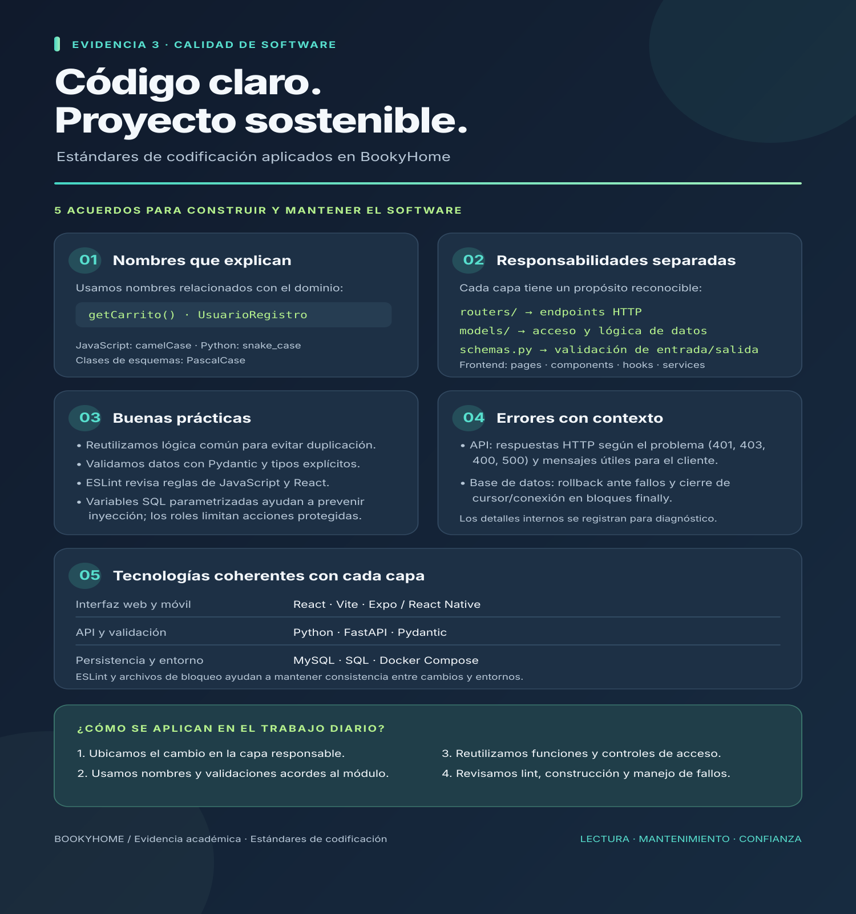

# Evidencia 3: estándares de codificación

## Infografía

## Cómo aplicamos los estándares al proyecto

BookyHome está dividido en una aplicación web, una aplicación móvil, una API y una base de datos. Organizamos cada responsabilidad en módulos para que el equipo pueda encontrar el código y modificarlo con menor acoplamiento:

- **Frontend web:** páginas, componentes reutilizables, hooks y servicios API viven en áreas separadas bajo `frontend/src/`.
- **Backend:** `backend/app/routers/` reúne endpoints, `backend/app/models/` contiene operaciones de datos y negocio, y `backend/app/schemas.py` define los contratos y validaciones.
- **Persistencia:** MySQL y sus cambios se gestionan en `database/`, incluidas migraciones numeradas.

En los nombres se usan términos del dominio —por ejemplo `getCarrito`, `UsuarioRegistro` y `crear_usuario`— y convenciones propias del lenguaje: camelCase en buena parte del JavaScript, snake_case en Python y PascalCase para clases. Hay módulos heredados con estilos variados; la infografía resume los patrones que se observan, no afirma que cada archivo histórico tenga formato uniforme.

Aplicamos validación para rechazar datos inválidos cerca de la entrada: los esquemas Pydantic declaran tipos, longitudes, rangos y formatos; por ejemplo, `UsuarioRegistro` valida email, contraseña, teléfono y rol, y `LibroCrear` restringe precio, stock y estado. En el frontend, ESLint usa reglas recomendadas para JavaScript, hooks de React y actualización de componentes.

Para evitar defectos y riesgos comunes, centralizamos llamadas HTTP en servicios Axios, reutilizamos helpers para operaciones repetidas y parametrizamos valores de consultas SQL. La autenticación usa tokens y las rutas sensibles pueden exigir roles. En el manejo de errores, FastAPI devuelve códigos HTTP y mensajes adecuados al caso; las operaciones de base de datos revierten cambios ante fallos y cierran recursos en `finally`.

Las herramientas principales son React y Vite para la web, Expo/React Native para móvil, Python y FastAPI para la API, Pydantic para validación, MySQL para persistencia y Docker Compose para levantar los servicios. Los archivos de dependencias bloqueadas (`pnpm-lock.yaml` y `uv.lock`) ayudan a reproducir versiones del entorno.

## Referencias del repositorio

- Convenciones y estructura: [`README.md`](../../README.md)
- Configuración de ESLint: [`frontend/eslint.config.js`](../../frontend/eslint.config.js)
- Cliente HTTP centralizado: [`frontend/src/services/api.js`](../../frontend/src/services/api.js)
- Validación de datos: [`backend/app/schemas.py`](../../backend/app/schemas.py)
- Autenticación y manejo de respuestas: [`backend/app/routers/usuarios.py`](../../backend/app/routers/usuarios.py)
- Dependencias del backend: [`backend/pyproject.toml`](../../backend/pyproject.toml)
