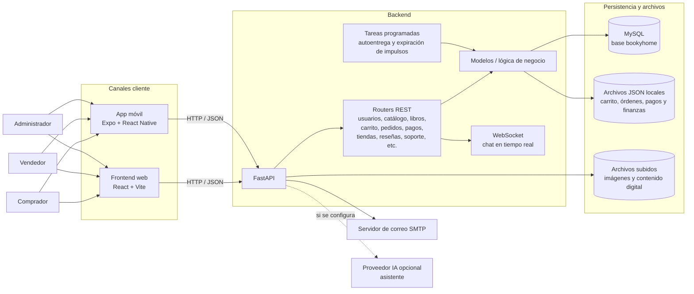
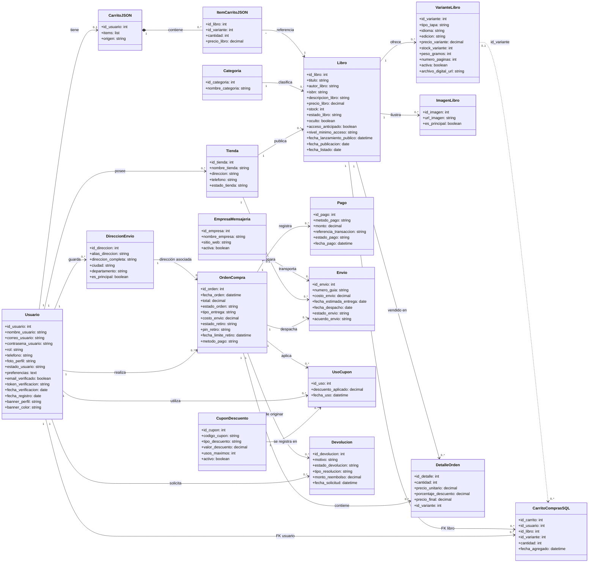
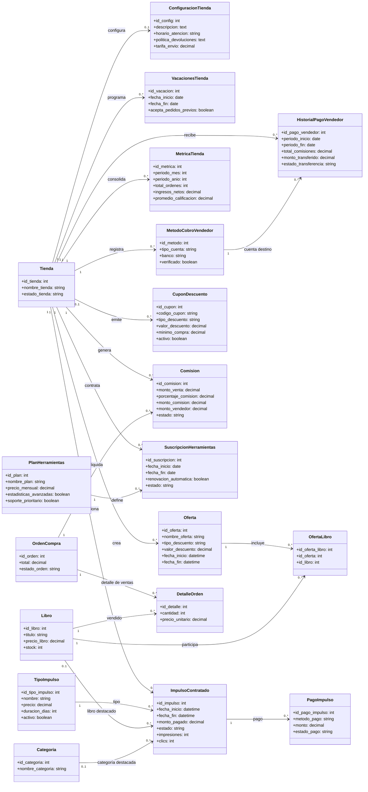
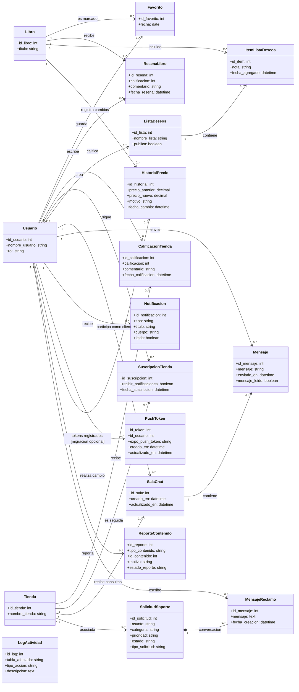
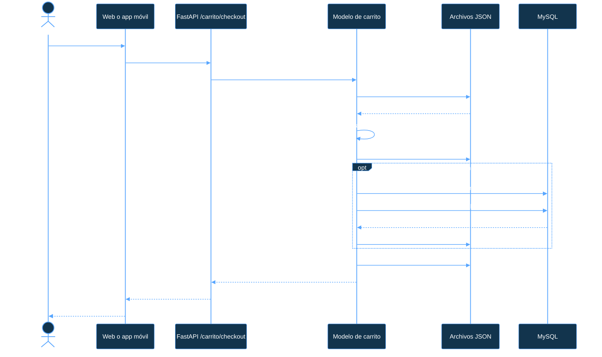

# Diagramas UML de BookyHome

## Alcance y fuentes

Este documento describe la arquitectura y el modelo de dominio que se encuentran implementados en el repositorio. La referencia principal para las entidades y sus claves foráneas es `database/bookyhome.sql` (43 tablas). También se contrastaron las migraciones, las ampliaciones de esquema que ejecuta `backend/app/database.py`, los routers/modelos FastAPI y los clientes web y móvil. La migración `008_add_push_tokens.sql` define una tabla adicional que no está en el SQL inicial; se identifica por separado porque su existencia depende de que esa migración se haya aplicado y el backend actual no contiene operaciones que la usen.

El proyecto no está implementado como un conjunto de clases de dominio Python: la lógica de negocio está distribuida entre routers y funciones de modelos, mientras que las entidades persistentes son tablas MySQL. Por eso, los diagramas de clases representan principalmente el **modelo de datos relacional**. Al final se incluye también la vista de clases Python que sí existen, los DTO Pydantic y los componentes funcionales de los clientes; no se presentan páginas React como clases de dominio.

Los bloques Mermaid pueden visualizarse en GitHub, en VS Code con una extensión compatible con Mermaid o copiarse a un editor Mermaid para exportarlos como imagen. Los casos de uso se documentan por separado en [`casos-de-uso/README.md`](../casos-de-uso/README.md), con imágenes PNG separadas por plataforma.

## 1. Arquitectura general

Vista lógica de los clientes, API, persistencia y servicios de soporte. En ejecución local, Docker Compose contiene MySQL, el backend y el frontend web; la aplicación Expo se ejecuta por separado.

### Componentes y responsabilidades

| Componente | Responsabilidad comprobada |
|---|---|
| Frontend web | Interfaz para comprador, vendedor y administración. Consume la API con Axios y adjunta el token JWT en las peticiones autenticadas. |
| App móvil | Cliente Expo/React Native con navegación y pantallas por rol. Consume la misma API mediante `EXPO_PUBLIC_API_URL`. |
| FastAPI | Expone endpoints REST por módulos, sirve archivos estáticos/subidos y registra el WebSocket de chat. |
| Routers y modelos | Los routers validan/autorizan operaciones; algunos delegan en funciones de `backend/app/models/` y otros consultan MySQL directamente. |
| MySQL | Persistencia relacional principal: usuarios, tiendas, catálogo, órdenes, pagos, envíos y módulos asociados. |
| JSON local | El modelo de carrito usa `cart_store.json`; el checkout también mantiene órdenes en `orders.json`. Los flujos de finanzas usan `finanzas.json` y `pagos_vendedores.json`. El código intenta reflejar las órdenes y sus detalles en MySQL. |
| WebSocket | `ConnectionManager` mantiene conexiones activas en memoria y entrega eventos a usuarios conectados. El router de chat persiste mensajes y notificaciones en MySQL. |
| Scheduler | Registra tareas para auto-confirmar entregas y expirar impulsos vencidos. |
| SMTP / IA | El correo se usa, entre otros flujos, para autenticación y notificaciones. El proveedor de IA es opcional; el asistente tiene un flujo local de respaldo. |

## 2. Diagrama UML de catálogo, carrito y compra

Las multiplicidades reflejan las claves foráneas y las reglas de uso observadas. Las clases `CarritoJSON` e `ItemCarritoJSON` son estructuras lógicas del backend, no tablas MySQL.

### Cómo leer este modelo

- `Usuario.rol` contiene los roles de comprador, vendedor o administrador. En el esquema no hay tablas/clases separadas para cada tipo de usuario.
- Una tienda pertenece a un usuario vendedor. El esquema permite técnicamente más de una tienda por usuario porque `tiendas.id_usuario` es una FK, no una clave única.
- Cada libro pertenece a una tienda y a una categoría. Imágenes y variantes dependen de un libro.
- `DetalleOrden` es la entidad asociativa entre una orden y los libros vendidos; almacena cantidad y el precio histórico aplicado.
- Una orden puede agrupar productos de más de una tienda. Por eso el sistema puede registrar varios envíos por orden, uno por tienda participante.
- `Pago`, `Envio` y `Devolucion` son conceptos distintos: el pago registra el cobro, el envío el cumplimiento logístico y la devolución una solicitud posterior.
- Los campos de retiro en tienda (`tipo_entrega`, `estado_retiro`, `pin_retiro`, `fecha_limite_retiro`) y otras columnas se agregan mediante rutinas de aseguramiento de esquema, no todas aparecen en la definición inicial de la tabla.
- `usuarios.banner_perfil` y `usuarios.banner_color` también se agregan al iniciar FastAPI. `libros.acceso_anticipado`, `nivel_minimo_acceso` y `fecha_lanzamiento_publico` se agregan de la misma forma; por ello están en el modelo lógico aunque no en el `CREATE TABLE` inicial.
- `libro_variantes.archivo_digital_url` se agrega mediante la migración 017. No debe suponerse que exista en una instalación que no haya aplicado esa migración.
- `id_variante` en carrito y detalle se incorporó mediante migración. El diagrama lo marca como referencia opcional; la migración añade la FK en carrito, pero no declara una FK equivalente para `detalle_orden`.
- La tabla SQL `carrito_compras` existe, pero el modelo activo `backend/app/models/carrito.py` lee y escribe el carrito en JSON. No se debe explicar la tabla SQL como si fuera el almacenamiento único o principal del carrito actual.

## 3. Diagrama UML del vendedor, promociones e ingresos

Este diagrama agrupa configuración de la tienda, herramientas de vendedor, promociones y liquidación. Las ofertas y los libros tienen una relación muchos-a-muchos resuelta por `oferta_libros`.

### Observaciones de negocio

- `OfertaLibro` resuelve la relación entre ofertas y libros; una oferta puede incluir varios libros y un libro puede aparecer en varias ofertas.
- `CuponDescuento.id_tienda` admite `NULL`, por lo que un cupón puede ser general o estar asociado a una tienda.
- La comisión queda asociada tanto a la orden como a la tienda. El detalle vendido permite identificar la tienda a partir del libro.
- `HistorialPagoVendedor` registra transferencias a una cuenta guardada en `MetodoCobroVendedor`.
- Las suscripciones de herramientas de vendedor (`suscripciones_herramientas`) no son lo mismo que seguir una tienda (`suscripciones_tienda`). El router `/suscripciones` también intenta guardar planes de tienda en `suscripciones_tienda`, pero los campos que consulta no están declarados en el esquema inicial ni en las migraciones halladas.
- Hay una inconsistencia comprobable entre esquema y código: el SQL inicial define `suscripciones_tienda` como relación usuario-tienda (seguir una tienda); `backend/app/models/suscripciones_tienda.py` consulta e inserta además `plan_suscripcion`, `estado_suscripcion`, `fecha_inicio`, `fecha_fin`, `precio_pagado` y `metodo_pago`. No se encontró una migración que agregue esos campos. El diagrama conserva la entidad según el esquema y señala el desacuerdo; no inventa una tabla de planes separada para ese flujo.
- Un impulso contratado requiere un tipo y una tienda; su objetivo puede ser un libro o una categoría. Su pago se guarda en `pagos_impulsos`.
- Las tablas de métricas y varias vistas/procedimientos SQL son datos de resumen y consulta; no sustituyen las entidades transaccionales.

## 4. Diagrama UML de interacción, comunidad y soporte

### Notas de integridad del modelo

- `salasChats` tiene una restricción única por pareja usuario-tienda; en consecuencia, el modelo permite una sala de atención por cada combinación.
- La tabla `reportes_contenido` identifica el objeto reportado mediante `tipo_contenido` e `id_contenido`; es una referencia polimórfica y no tiene una FK directa hacia libro/reseña/tienda/mensaje.
- `solicitudes_soporte` contiene `id_usuario` e `id_orden`, pero el SQL declara explícitamente FK solo para `id_tienda`. Por tanto, las relaciones a usuario y orden no se muestran como relaciones FK.
- `log_actividad` es una bitácora SQL genérica sin FK a las tablas afectadas; los triggers registran algunos eventos concretos, no una auditoría administrativa completa.
- `PushToken` representa la tabla `push_tokens` de la migración opcional 008. Su FK a usuario tiene `ON DELETE CASCADE`, pero no se incluye en el esquema inicial ni hay acceso a esa tabla en el backend revisado.
- La tabla `favoritos` representa la lista predeterminada de favoritos; las listas personalizadas se modelan aparte con `lista_deseos` y `lista_deseos_libros`.
- Las calificaciones de libros (`resenas_libros`) y las calificaciones de tiendas (`calificaciones_tiendas`) son entidades diferentes.
- `calificaciones_tiendas` existe como tabla. El router independiente de calificaciones no se registra en `main.py`, aunque `perfil.py` contiene endpoints activos para operaciones equivalentes.

## 5. Secuencia de checkout (flujo implementado)

La colección de diagramas de secuencia —con flujos de registro, recuperación, catálogo, compra, perfil, publicación, ofertas, chat, notificaciones, soporte, moderación, devoluciones, envíos/retiro, herramientas, impulsos y finanzas— se documenta en [`diagramas-secuencia-bookyhome.md`](../diagramas-de-secuencia/diagramas-secuencia-bookyhome.md). Sus limitaciones reales se identifican para no presentar como terminado un requisito parcial o pendiente.

La secuencia distingue el flujo del carrito del mecanismo relacional, porque el checkout conserva datos en JSON y luego intenta reflejarlos en MySQL.

**Punto importante para la sustentación:** en `checkout_carrito`, el guardado JSON es el flujo base; la escritura en MySQL está dentro de un bloque de persistencia secundaria cuyo fallo se captura. Por eso, el código puede devolver una orden creada en JSON aunque el reflejo SQL no se haya completado. Es una característica/limitación actual de la implementación, no una garantía de transacción distribuida.

## 6. Inventario de entidades SQL cubiertas

La definición principal del esquema contiene 43 tablas, todas representadas en los diagramas de clases de las secciones 2–4 y en el inventario de campos de la sección 10. Se agrupan aquí para ubicar rápidamente cada módulo:

| Área | Tablas |
|---|---|
| Identidad y perfil | `usuarios`, `direcciones_envio`, `notificaciones` |
| Tienda y catálogo | `tiendas`, `categorias`, `libros`, `imagenes_libro`, `libro_variantes`, `tienda_configuracion`, `tienda_vacaciones`, `historial_precios` |
| Compra y postventa | `carrito_compras`, `ordenes_compra`, `detalle_orden`, `pagos`, `envios`, `empresas_mensajeria`, `devoluciones` |
| Promoción, herramientas y finanzas | `ofertas`, `oferta_libros`, `cupones_descuento`, `uso_cupones`, `comisiones`, `historial_pagos_vendedor`, `metodos_cobro_vendedor`, `metricas_tienda`, `tipos_impulso`, `impulsos_contratados`, `pagos_impulsos`, `planes_herramientas`, `suscripciones_herramientas` |
| Comunidad y comunicación | `favoritos`, `resenas_libros`, `calificaciones_tiendas`, `suscripciones_tienda`, `lista_deseos`, `lista_deseos_libros`, `salasChats`, `mensajes` |
| Moderación y soporte | `reportes_contenido`, `solicitudes_soporte`, `mensajes_reclamo` |
| Registro de eventos SQL | `log_actividad` |

Además de estas tablas, el SQL contiene vistas, procedimientos almacenados y triggers para búsquedas, reportes, métricas, notificaciones, comisiones, disponibilidad e inventario. No se dibujan como entidades porque son lógica de consulta/automatización y no objetos de dominio persistentes independientes.

La clase adicional `PushToken` corresponde a la tabla `push_tokens`, definida solo en [`database/migrations/008_add_push_tokens.sql`](../../database/migrations/008_add_push_tokens.sql): `id_token`, `id_usuario`, `expo_push_token`, `creado_en` y `actualizado_en`. Tiene FK a `usuarios` con borrado en cascada, pero no está en `bookyhome.sql` ni se encontró código backend que la consulte; se considera una extensión opcional del esquema, no una dependencia garantizada de la aplicación.

## 7. Diferencias principales frente al diagrama anterior

1. **Roles:** `ValidacionRol` no es una entidad del esquema. El rol está en `usuarios.rol` y los permisos se aplican en autenticación/autorización del backend.
2. **Catálogo:** se agregaron tienda, categoría, imágenes, variantes, ofertas y el estado de visibilidad/acceso anticipado de libros.
3. **Compra:** se reemplazó la idea de un único objeto “CarritoCompras → Transacción” por las entidades efectivas `ordenes_compra`, `detalle_orden`, `pagos` y `envios`, más el carrito JSON que usa el backend.
4. **Postventa:** se incorporaron cupones, devoluciones, seguimiento/envíos y entrega/retiro en tienda.
5. **Herramientas del vendedor:** se agregaron comisiones, métodos y pagos a vendedor, métricas, suscripciones de herramientas, impulsos y su pago.
6. **Interacción:** se distinguen reseñas de libros, calificaciones de tienda, favoritos, listas personalizadas, seguidores, chats/notificaciones y soporte.
7. **Trazabilidad:** los diagramas muestran relaciones de claves foráneas. Las referencias polimórficas o campos que no tienen FK explícita se identifican en las notas para no presentarlos como integridad garantizada por MySQL.

## 8. Guion breve para sustentar

> “BookyHome es una plataforma de comercio electrónico tipo marketplace para libros. La arquitectura tiene dos clientes —web en React/Vite y móvil en Expo/React Native— que consumen una API FastAPI. El backend concentra las reglas de negocio y se conecta a MySQL, además de gestionar algunos archivos JSON y archivos subidos.
>
> El núcleo del modelo es Usuario–Tienda–Libro. Un vendedor administra una tienda y publica libros clasificados por categoría, con imágenes y variantes. En una compra, la orden pertenece a un usuario y contiene detalles que relacionan libros, cantidades y precios; luego se asocian pagos, envíos y, cuando aplica, devoluciones. El modelo también contempla promociones, cupones y liquidación de comisiones al vendedor.
>
> Como módulos complementarios existen reseñas, calificaciones, favoritos, listas de deseos, chat, notificaciones y soporte. Los diagramas separan esos módulos para que se vean las relaciones sin saturar una sola lámina. Una particularidad técnica vigente es que el carrito y el checkout usan JSON como almacenamiento base y el checkout intenta sincronizar la orden con MySQL; por eso el diagrama deja explícita esa dualidad.”

### Preguntas frecuentes

**¿Por qué Usuario no tiene subclases Comprador, Vendedor y Administrador?**  
Porque el esquema almacena los perfiles en una sola tabla y distingue su tipo por el campo `rol`.

**¿Por qué `DetalleOrden` es una entidad y no una relación directa?**  
Porque la relación orden-libro necesita guardar atributos propios: cantidad, precio unitario y descuentos. Es una entidad asociativa.

**¿Por qué aparecen JSON y MySQL al mismo tiempo?**  
Porque el carrito se maneja mediante archivos JSON en el modelo actual y el checkout conserva la orden en JSON mientras intenta persistir una copia relacional. El UML debe reflejar la implementación presente, no ocultar esa diferencia.

**¿Un pago es lo mismo que una orden?**  
No. La orden representa lo solicitado; el pago registra el intento/resultado de cobro. Una orden puede tener cero o varios registros de pago.

**¿Por qué una orden puede tener varios envíos?**  
El marketplace vende libros de distintas tiendas. El esquema de envíos asocia cada envío tanto a una orden como a una tienda, permitiendo separar la preparación logística.

**¿Los diagramas muestran todas las tablas?**  
Sí. Las 43 tablas del esquema principal están representadas; la sección 10 enumera todos sus campos. También se identifica `push_tokens`, que solo aparece en una migración opcional. Las vistas, triggers y procedimientos se documentan aparte porque son lógica SQL, no entidades.

## 9. Clases y componentes que existen en el código

Este diagrama complementa el modelo de datos: identifica clases Python reales y los límites entre los clientes, la API y la persistencia. Los routers y modelos de datos Python se implementan mayormente como módulos con funciones, no como clases instanciadas; por eso llevan el estereotipo `«módulo»`. Las páginas, componentes y contextos React son funciones/componentes y no clases de dominio.

```mermaid
classDiagram
    direction LR

    class AplicacionWeb {
        <<React>>
        +entryPoint: string
    }
    class ClienteAPIWeb {
        <<Modulo>>
        +entryPoint: string
        +cliente: Axios
        +autorizacion: JWT
    }
    class AppMovil {
        <<ReactNative>>
        +entryPoint: string
    }
    class SafeAreaProvider {
        <<Componente>>
        +componente: string
    }
    class NavegadorMovil {
        <<Componente>>
        +nombre: string
    }
    class RootNavigation {
        <<Componente>>
        +componente: string
    }
    class AuthProvider {
        <<Componente>>
        +contexto: string
        +autenticacion: JWT
        +biometria: boolean
    }
    class CartProvider {
        <<Componente>>
        +contexto: string
    }
    class NotificationProvider {
        <<Componente>>
        +contexto: string
    }
    class ChatSocketProvider {
        <<Componente>>
        +contexto: string
        +transporte: WebSocket
    }
    class ThemeProvider {
        <<Componente>>
        +contexto: string
    }
    class ClienteAPIMovil {
        <<Modulo>>
        +entryPoint: string
        +cliente: Axios
        +autorizacion: JWT
    }
    class FastAPI {
        <<Aplicacion>>
        +entryPoint: string
    }
    class RoutersREST {
        <<Modulos>>
        +dominios: string
        +transporte: HTTP_WebSocket
    }
    class ModelosBackend {
        <<ModulosFuncionales>>
        +ubicacion: string
        +responsabilidad: string
    }
    class MaxBodySizeMiddleware {
        <<ClasePython>>
        +dispatch(): Response
    }
    class ConnectionManager {
        <<ClasePython>>
        +connect(): void
        +disconnect(): void
        +esta_conectado(): boolean
        +enviar_a_usuario(): boolean
    }
    class BookyPagoFinanzas {
        <<ClasePython>>
        +obtener_balance(): Dict
        +registrar_ingreso_venta(): Dict
        +registrar_ingreso_plan(): Dict
        +registrar_ingreso_impulso(): Dict
        +obtener_nomina(): Dict
        +procesar_nomina_vendedor(): Dict
        +procesar_pago_vendedor(): Dict
        +obtener_historial_financiero(): Dict
        +obtener_estadisticas(): Dict
    }
    class FinanzasDB {
        <<ModuloFuncional>>
        +responsabilidad: string
    }
    class DTOsPydantic {
        <<DTO>>
        +rol: string
    }
    class MySQL {
        <<Persistencia>>
    }
    class ArchivosJSON {
        <<PersistenciaLocal>>
        +carrito: JSON
        +ordenes: JSON
        +finanzas: JSON
    }

    AplicacionWeb --> ClienteAPIWeb
    ClienteAPIWeb --> FastAPI : HTTP/JSON
    AppMovil o-- SafeAreaProvider
    SafeAreaProvider o-- AuthProvider
    AuthProvider o-- ThemeProvider
    ThemeProvider o-- NotificationProvider
    NotificationProvider o-- ChatSocketProvider
    ChatSocketProvider o-- CartProvider
    CartProvider o-- RootNavigation
    RootNavigation --> NavegadorMovil
    NavegadorMovil ..> AuthProvider : consume contexto
    NavegadorMovil ..> ThemeProvider : consume contexto
    CartProvider ..> AuthProvider : consume contexto
    ChatSocketProvider ..> AuthProvider : consume contexto
    ChatSocketProvider ..> NotificationProvider : consume contexto
    AuthProvider --> ClienteAPIMovil
    CartProvider --> ClienteAPIMovil
    NotificationProvider --> ClienteAPIMovil
    ChatSocketProvider --> ClienteAPIMovil
    ClienteAPIMovil --> FastAPI : HTTP/JSON
    ChatSocketProvider ..> ConnectionManager : WebSocket
    FastAPI o-- RoutersREST
    FastAPI o-- MaxBodySizeMiddleware
    RoutersREST ..> DTOsPydantic
    RoutersREST ..> ModelosBackend
    RoutersREST ..> BookyPagoFinanzas
    RoutersREST ..> FinanzasDB
    RoutersREST --> MySQL : endpoints con consultas directas
    ModelosBackend --> MySQL
    ModelosBackend --> ArchivosJSON
    BookyPagoFinanzas --> ArchivosJSON
    FinanzasDB --> MySQL
    FinanzasDB --> ArchivosJSON : pagos operativos JSON
```

### Inventario de clases Python y DTO

Además de `MaxBodySizeMiddleware`, `ConnectionManager` y `BookyPagoFinanzas`, el backend declara modelos Pydantic para validar entradas y salidas. Estos DTO no son tablas ni entidades persistentes:

| Archivo/módulo | Clases y tipos declarados |
|---|---|
| `app/schemas.py` | `UsuarioRegistro`, `UsuarioLogin`, `UsuarioRespuesta`, `LibreriaRegistro`, `Token`, `OcultarPayload`, `LibroCrear`, `LibroRespuesta`, `CategoriaRespuesta`, `PagoRequest`, `CancelacionOrdenRequest`, `EstadoTiendaPayload` |
| `routers/auth.py` | `ForgotPasswordRequest`, `ResetPasswordRequest` |
| `routers/asistente.py` | `MensajeChat`, `ChatRequest`, `ChatResponse` |
| `routers/bookypago_finanzas.py` | `NominaRequest`, `CuentaBancaria` |
| `routers/chat.py` | `MensajeCreate`, `SalaCreate`, `MensajeResponse`, `SalaChat` |
| `routers/calificaciones_tiendas.py` | `CalificacionTiendaCreate`, `CalificacionTiendaResponse` |
| `routers/envios.py`, `routers/devoluciones.py` | `RegistroEnvio`, `DevolucionCrear` |
| `routers/direcciones.py` | `DireccionCrear`, `DireccionActualizar` |
| `routers/herramientas.py`, `routers/impulsos.py`, `routers/libreria.py` | `SuscripcionRequest`, `ImpulsoRequest`, `TiendaUpdate` |
| `routers/historial_interacciones.py` | `TipoInteraccion` (enum), `InteraccionCreate`, `InteraccionResponse` |
| `routers/lista_deseos.py` | `ListaDeseosCrear`, `ListaDeseosActualizar`, `LibroListaDeseosCrear` |
| `routers/notificaciones.py` | `TipoNotificacion` (enum), `NotificacionCreate`, `NotificacionResponse` |
| `routers/perfil.py` | `ActualizarEstadoOrden`, `PerfilActualizar`, `DireccionBase`, `DireccionCrear`, `CanalNotificacion`, `PreferenciasUsuario`, `PerfilRespuesta`, `EstadisticasRespuesta`, `BannerColorData`, `CambiarPassword`, `CalificacionTiendaCreate` |
| `routers/quejas.py` | `Resolucion`, `SoporteCrear`, `MensajeReclamo` |
| `routers/resenas.py`, `routers/suscripciones_tienda.py`, `routers/usuarios.py` | `ResenaCreate`, `ResenaResponse`, `SuscripcionCrear`, `BloquearPayload` |

En web y móvil los datos del dominio se representan como objetos JavaScript y componentes funcionales. La app móvil añade los proveedores `AuthProvider`, `CartProvider`, `ChatSocketProvider`, `NotificationProvider` y `ThemeProvider`; no existe una jerarquía JavaScript de entidades/clases equivalente al modelo SQL.

### Persistencia financiera y del carrito

- `CarritoJSON` y `ItemCarritoJSON` representan datos del flujo activo de carrito. La tabla `carrito_compras` existe, pero el modelo `app/models/carrito.py` opera sobre `cart_store.json`; el checkout escribe primero en `orders.json` e intenta guardar también la orden y sus detalles en MySQL.
- `BookyPagoFinanzas` es una clase de servicio que lee/escribe `finanzas.json` y `pagos_vendedores.json`. El router financiero consulta el módulo funcional `finanzas_db.py` para balance, historial, estadísticas y nómina, combinando consultas MySQL con archivos JSON. Las tablas `comisiones`, `historial_pagos_vendedor`, `pagos_impulsos` y suscripciones guardan registros relacionados, pero no son una única tabla contable que sustituya esos flujos.
- `ConnectionManager` mantiene sockets activos por usuario en memoria. El router de chat autentica y persiste los mensajes; el administrador de conexiones no es una entidad SQL.

## 10. Inventario exhaustivo de atributos persistentes

La siguiente matriz transcribe los nombres de **todos los campos** de las 43 tablas de `database/bookyhome.sql`. Las clases con nombres traducidos o en singular corresponden a la tabla indicada. Las claves y cardinalidades se muestran en las relaciones Mermaid anteriores; los tipos, nulabilidad, valores por defecto e índices deben consultarse en el DDL y las migraciones aplicables, que pueden modificarlos.

| Tabla SQL | Clase del diagrama | Campos del esquema inicial |
|---|---|---|
| `usuarios` | `Usuario` | `id_usuario`, `nombre_usuario`, `correo_usuario`, `contrasena_usuario`, `rol`, `telefono`, `foto_perfil`, `estado_usuario`, `preferencias`, `email_verificado`, `token_verificacion`, `fecha_verificacion`, `fecha_registro` |
| `tiendas` | `Tienda` | `id_tienda`, `id_usuario`, `nombre_tienda`, `direccion`, `telefono`, `estado_tienda`, `fecha_creacion` |
| `direcciones_envio` | `DireccionEnvio` | `id_direccion`, `id_usuario`, `alias_direccion`, `direccion_completa`, `ciudad`, `departamento`, `codigo_postal`, `es_principal` |
| `categorias` | `Categoria` | `id_categoria`, `nombre_categoria` |
| `libros` | `Libro` | `id_libro`, `id_tienda`, `id_categoria`, `titulo`, `autor_libro`, `isbn`, `descripcion_libro`, `precio_libro`, `stock`, `oculto`, `estado_libro`, `fecha_publicacion`, `fecha_listado` |
| `imagenes_libro` | `ImagenLibro` | `id_imagen`, `id_libro`, `url_imagen`, `es_principal` |
| `ofertas` | `Oferta` | `id_oferta`, `id_tienda`, `nombre_oferta`, `tipo_descuento`, `valor_descuento`, `fecha_inicio`, `fecha_fin` |
| `favoritos` | `Favorito` | `id_favorito`, `id_usuario`, `id_libro`, `fecha` |
| `resenas_libros` | `ResenaLibro` | `id_resena`, `id_usuario`, `id_libro`, `calificacion`, `comentario`, `fecha_resena` |
| `calificaciones_tiendas` | `CalificacionTienda` | `id_calificacion`, `id_usuario`, `id_tienda`, `calificacion`, `comentario`, `fecha_calificacion` |
| `ordenes_compra` | `OrdenCompra` | `id_orden`, `id_usuario`, `id_direccion_envio`, `fecha_orden`, `total`, `estado_orden` |
| `detalle_orden` | `DetalleOrden` | `id_detalle`, `id_orden`, `id_libro`, `cantidad`, `precio_unitario`, `porcentaje_descuento`, `precio_final` |
| `pagos` | `Pago` | `id_pago`, `id_orden`, `metodo_pago`, `monto`, `referencia_transaccion`, `fecha_pago`, `estado_pago` |
| `envios` | `Envio` | `id_envio`, `id_orden`, `id_tienda`, `id_empresa`, `empresa_mensajeria`, `numero_guia`, `costo_envio`, `fecha_estimada_entrega`, `fecha_despacho`, `estado_envio`, `acuerdo_envio` |
| `salasChats` | `SalaChat` | `id_sala`, `id_usuario`, `id_tienda`, `creado_en`, `actualizado_en` |
| `mensajes` | `Mensaje` | `id_mensaje`, `id_sala`, `id_remitente`, `mensaje`, `enviado_en`, `mensaje_leido` |
| `log_actividad` | `LogActividad` | `id_log`, `tabla_afectada`, `tipo_accion`, `descripcion`, `fecha_log` |
| `empresas_mensajeria` | `EmpresaMensajeria` | `id_empresa`, `nombre_empresa`, `sitio_web`, `telefono_soporte`, `cobertura_nacional`, `activa` |
| `oferta_libros` | `OfertaLibro` | `id_oferta_libro`, `id_oferta`, `id_libro` |
| `carrito_compras` | `CarritoComprasSQL` | `id_carrito`, `id_usuario`, `id_libro`, `cantidad`, `fecha_agregado` |
| `cupones_descuento` | `CuponDescuento` | `id_cupon`, `id_tienda`, `codigo_cupon`, `tipo_descuento`, `valor_descuento`, `minimo_compra`, `usos_maximos`, `usos_actuales`, `fecha_inicio`, `fecha_fin`, `activo` |
| `uso_cupones` | `UsoCupon` | `id_uso`, `id_cupon`, `id_usuario`, `id_orden`, `descuento_aplicado`, `fecha_uso` |
| `devoluciones` | `Devolucion` | `id_devolucion`, `id_orden`, `id_usuario`, `motivo`, `estado_devolucion`, `tipo_resolucion`, `monto_reembolso`, `fecha_solicitud`, `fecha_resolucion`, `notas_vendedor` |
| `notificaciones` | `Notificacion` | `id_notificacion`, `id_usuario`, `tipo`, `titulo`, `cuerpo`, `leida`, `id_referencia`, `fecha_creacion` |
| `historial_precios` | `HistorialPrecio` | `id_historial`, `id_libro`, `precio_anterior`, `precio_nuevo`, `motivo`, `cambiado_por`, `fecha_cambio` |
| `reportes_contenido` | `ReporteContenido` | `id_reporte`, `id_usuario_reporta`, `tipo_contenido`, `id_contenido`, `motivo`, `estado_reporte`, `fecha_reporte`, `fecha_resolucion` |
| `suscripciones_tienda` | `SuscripcionTienda` | `id_suscripcion`, `id_usuario`, `id_tienda`, `recibir_notificaciones`, `fecha_suscripcion` |
| `lista_deseos` | `ListaDeseos` | `id_lista`, `id_usuario`, `nombre_lista`, `publica`, `fecha_creacion` |
| `lista_deseos_libros` | `ItemListaDeseos` | `id_item`, `id_lista`, `id_libro`, `nota`, `fecha_agregado` |
| `tienda_configuracion` | `ConfiguracionTienda` | `id_config`, `id_tienda`, `descripcion`, `logo_url`, `banner_url`, `horario_atencion`, `politica_devoluciones`, `politica_envios`, `tiempo_despacho_dias`, `ciudad_origen`, `acepta_negociacion`, `email_publico`, `redes_sociales`, `tarifa_envio`, `fecha_actualizacion` |
| `metodos_cobro_vendedor` | `MetodoCobroVendedor` | `id_metodo`, `id_tienda`, `tipo_cuenta`, `banco`, `numero_cuenta`, `nombre_titular`, `cedula_titular`, `es_principal`, `verificado`, `fecha_registro` |
| `tienda_vacaciones` | `VacacionesTienda` | `id_vacacion`, `id_tienda`, `fecha_inicio`, `fecha_fin`, `mensaje_clientes`, `acepta_pedidos_previos`, `creado_en` |
| `libro_variantes` | `VarianteLibro` | `id_variante`, `id_libro`, `tipo_tapa`, `idioma`, `edicion`, `isbn`, `precio_variante`, `stock_variante`, `peso_gramos`, `numero_paginas`, `activa` |
| `metricas_tienda` | `MetricaTienda` | `id_metrica`, `id_tienda`, `periodo_mes`, `periodo_anio`, `total_ordenes`, `ordenes_completadas`, `ordenes_canceladas`, `ingresos_brutos`, `ingresos_netos`, `promedio_calificacion`, `nuevos_seguidores`, `libros_mas_vendido`, `fecha_calculo` |
| `comisiones` | `Comision` | `id_comision`, `id_orden`, `id_tienda`, `monto_venta`, `porcentaje_comision`, `monto_comision`, `monto_vendedor`, `estado`, `fecha_generacion`, `fecha_pago_vendedor` |
| `historial_pagos_vendedor` | `HistorialPagoVendedor` | `id_pago_vendedor`, `id_tienda`, `periodo_inicio`, `periodo_fin`, `total_ventas`, `total_comisiones`, `total_reembolsos`, `monto_transferido`, `id_cuenta_destino`, `referencia_transferencia`, `estado_transferencia`, `fecha_transferencia` |
| `tipos_impulso` | `TipoImpulso` | `id_tipo_impulso`, `nombre`, `descripcion`, `precio`, `duracion_dias`, `tipo`, `activo` |
| `impulsos_contratados` | `ImpulsoContratado` | `id_impulso`, `id_tienda`, `id_tipo_impulso`, `id_libro`, `id_categoria`, `fecha_inicio`, `fecha_fin`, `monto_pagado`, `estado`, `impresiones`, `clics`, `ventas_generadas` |
| `pagos_impulsos` | `PagoImpulso` | `id_pago_impulso`, `id_impulso`, `metodo_pago`, `monto`, `referencia`, `estado_pago`, `fecha_pago` |
| `planes_herramientas` | `PlanHerramientas` | `id_plan`, `nombre_plan`, `precio_mensual`, `estadisticas_basicas`, `estadisticas_avanzadas`, `exportar_reportes`, `soporte_prioritario`, `historial_meses`, `impulsos_con_descuento`, `descripcion` |
| `suscripciones_herramientas` | `SuscripcionHerramientas` | `id_suscripcion`, `id_tienda`, `id_plan`, `fecha_inicio`, `fecha_fin`, `renovacion_automatica`, `estado`, `metodo_pago`, `monto_pagado` |
| `solicitudes_soporte` | `SolicitudSoporte` | `id_solicitud`, `id_tienda`, `id_usuario`, `id_orden`, `asunto`, `descripcion`, `categoria`, `prioridad`, `estado`, `respuesta`, `evidencia_url`, `tipo_solicitud`, `tiempo_respuesta_horas`, `fecha_creacion`, `fecha_resolucion` |
| `mensajes_reclamo` | `MensajeReclamo` | `id_mensaje`, `id_solicitud`, `id_usuario`, `mensaje`, `fecha_creacion` |

### Campos y tablas añadidos fuera del DDL inicial

| Objeto | Ampliación | Fuente |
|---|---|---|
| `usuarios` | `banner_perfil`, `banner_color` | `ensure_banner_perfil_schema()` en `backend/app/database.py` |
| `libros` | `acceso_anticipado`, `nivel_minimo_acceso`, `fecha_lanzamiento_publico` | `ensure_acceso_anticipado_libros_schema()` en `backend/app/database.py` |
| `ordenes_compra` | `tipo_entrega`, `estado_retiro`, `pin_retiro`, `fecha_limite_retiro`, `metodo_pago`, `costo_envio` | `ensure_retiro_schema()` en `backend/app/database.py` |
| `libro_variantes` | `archivo_digital_url` | Migración 017 |
| `carrito_compras` | `id_variante` y FK a `libro_variantes` | Migración 017 |
| `detalle_orden` | `id_variante` nullable, sin FK declarada | Migración 017 |
| `push_tokens` | Tabla opcional: `id_token`, `id_usuario`, `expo_push_token`, `creado_en`, `actualizado_en` | Migración 008; fuera de las 43 tablas del SQL inicial |
