# Flujo integral del proyecto BookyHome

## Propósito y alcance

Este documento reúne la vista general y los flujos funcionales y operativos de BookyHome. Se organiza en diagramas separados para que las relaciones entre clientes, API, persistencia, negocio y despliegue sean legibles.

Los diagramas distinguen entre:

- **Implementación:** flujo identificado en el código actual.
- **Parcial o pendiente:** requisito conocido que no está completo en la documentación de aceptación.
- **Alternativa documentada:** procedimiento o plataforma descritos en la documentación, que no necesariamente representan el entorno activo.

Cuando la documentación de alcance y el código no coinciden, este documento no presenta una funcionalidad planificada como si estuviera implementada. Los estados de requisitos se citan como estados documentados, no como una certificación independiente de cada criterio de aceptación.

## 1. Vista general del sistema

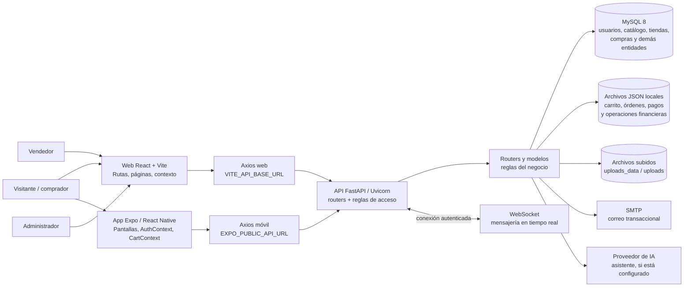

La web y la aplicación móvil son clientes distintos de la misma API. La app móvil se ejecuta por separado; en desarrollo debe usar una dirección del backend accesible desde el dispositivo. No se debe asumir que todas las pantallas o funciones web existen en móvil: cada cliente consume los endpoints que sus pantallas tienen implementados.

La persistencia no es una única fuente homogénea: MySQL almacena la mayoría de los datos; varios flujos de carrito, órdenes, pagos y BookyPago también usan JSON; y las imágenes/archivos viven en almacenamiento separado. Parte del acceso a MySQL se realiza desde routers y parte desde modelos, por lo que el diagrama no presupone una capa ORM única.

El asistente de IA ofrece respuestas locales cuando no hay proveedor configurado o falla la llamada; si está habilitado, Gemini tiene prioridad sobre OpenAI. El asistente usa el mensaje y el historial de conversación, no consulta en vivo libros ni órdenes. El correo depende de SMTP opcional. Los pagos se gestionan mediante la lógica interna descrita en la sección 4; no se identificó un proveedor externo de pagos integrado.

### Módulos de API registrados

| Grupo | Routers FastAPI incluidos |
|---|---|
| Cuenta y negocio | `usuarios`, `auth`, `libreria`, `perfil`, `direcciones`, `tienda_configuracion` |
| Catálogo y publicaciones | `catalogo`, `libros`, `stored`, `ofertas` |
| Compra y entrega | `carrito`, `payments`, `cupones`, `envios`, `devoluciones` |
| Comunidad | `chat`, `notificaciones`, `resenas`, `favoritos`, `lista_deseos`, `historial_interacciones` |
| Operación del vendedor y finanzas | `suscripciones_tienda`, `herramientas`, `impulsos`, `bookypago_finanzas` |
| Soporte y servicios | `quejas`, `asistente`, `health` |

El backend también expone WebSocket para chat y rutas estáticas de archivos subidos/digitales y recursos de correo. El módulo de calificaciones de tiendas aparece en el código, pero su router independiente no está incluido en `main.py`; hay rutas de calificación en otros módulos.

### 1.1 Inicialización de la API

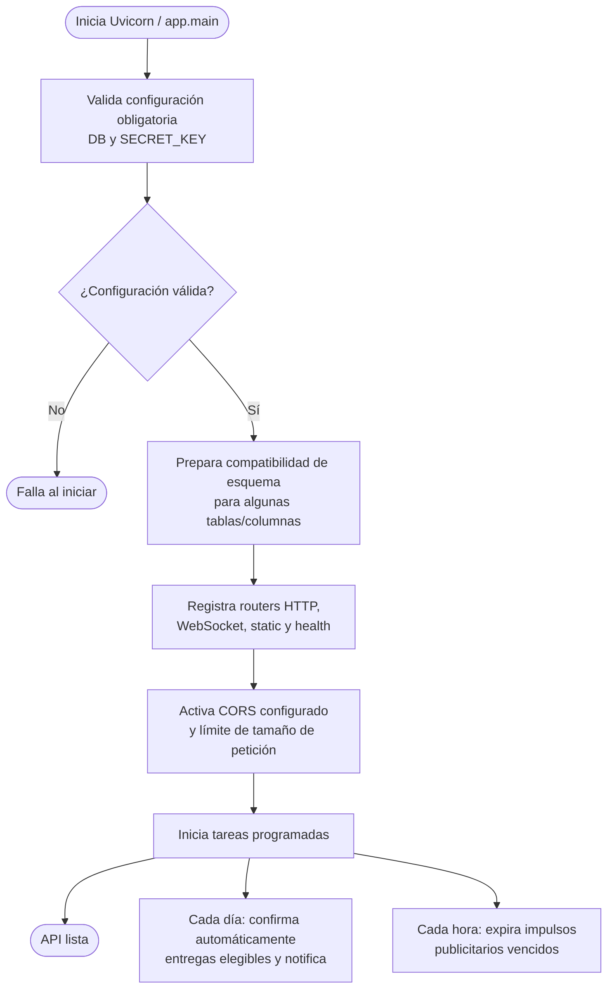

La conexión a MySQL usa `mysql.connector` síncrono y el helper reintenta conexiones hasta diez veces. El scheduler APScheduler confirma entregas que llevan diez días despachadas (una vez al día, 03:00 Bogotá) y expira impulsos vencidos cada hora. Algunas tareas de compatibilidad de esquema se intentan al arrancar; sus fallos se registran, pero no detienen la creación de la API. El middleware limita peticiones a 20 MiB cuando se proporciona `Content-Length` y aplica CORS configurado. SMTP y el proveedor de IA son opcionales; su ausencia no equivale a una base de datos disponible ni garantiza esos servicios. Algunas rutas manejan autenticación/roles con dependencias compartidas y otras con verificaciones propias, por lo que se debe revisar el endpoint específico al documentar permisos.

### 1.2 Clientes y navegación por rol

| Cliente | Inicio y sesión | Áreas representadas en el código |
|---|---|---|
| Web | React Router; sesión en `localStorage`; el encabezado administra login/registro y redirige por rol; rutas privadas usan `PrivateRoute`; la interfaz observa cambios de sesión y presencia del token. | Comprador: panel de inicio con catálogo, carrito, compras/seguimiento, perfil, direcciones, favoritos/listas, notificaciones, chat, quejas y soporte. Vendedor: tienda, libros, pedidos y herramientas. Administrador: gestión de usuarios, libros, tiendas, órdenes, finanzas, quejas y soporte. |
| Móvil | Expo restaura JWT desde AsyncStorage; contextos de autenticación, tema, notificaciones, chat y carrito; pila de navegación según rol. Puede bloquear/desbloquear con biometría según la configuración del dispositivo. | Comprador: catálogo, detalle, carrito, checkout, historial/seguimiento y pantallas personales. También existen pilas/pantallas de vendedor y administrador. Un token rechazado limpia la sesión móvil; el socket de chat reconecta con límites. |

El README web enumera páginas/rutas separadas que no reflejan exactamente la navegación actual: varias funciones viven dentro del panel de inicio y algunas rutas de registro/recuperación se abren desde el encabezado. La navegación del cliente no sustituye los permisos del servidor.

El acceso multidispositivo comparte la API, cuenta y datos remotos. Cada cliente conserva localmente su sesión/contexto y vuelve a cargar la información del usuario; esto no significa que exista una base de datos móvil independiente ni que todos los datos de UI se sincronicen automáticamente.

## 2. Inicio y acceso a los servicios

### 2.1 Entorno local de desarrollo

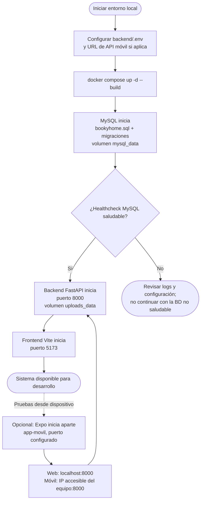

En el Compose local, MySQL, API y Vite se publican en los puertos 3306, 8000 y 5173. La base carga el esquema inicial al crear el volumen y el backend espera a que MySQL esté saludable. La app móvil no forma parte de este Compose.

### 2.2 Despliegue en servidor propio

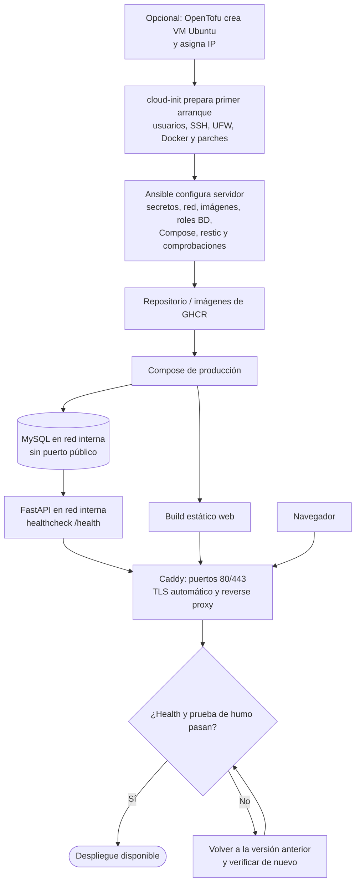

OpenTofu (con proveedor Hetzner en el ejemplo), cloud-init, Ansible y el laboratorio Docker son herramientas de infraestructura documentadas; su presencia en el repositorio no implica que una VM o una instalación productiva estén activas. En producción con Compose, Caddy expone el tráfico web/API; MySQL y FastAPI permanecen en la red Docker interna.

### 2.3 Liberación y rollback

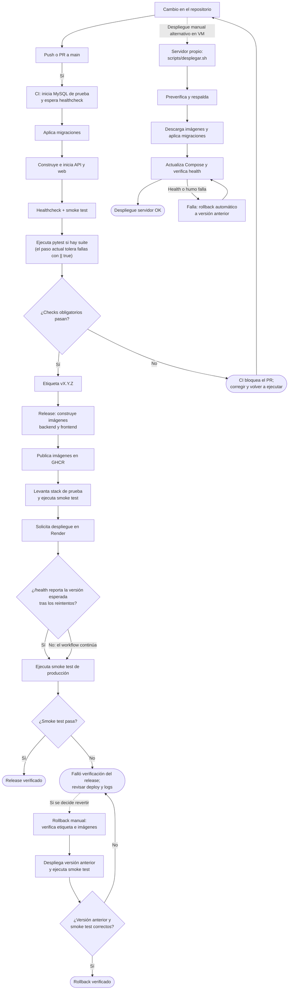

`ci.yml`, `release.yml` y `rollback.yml` describen rutas distintas. El procedimiento `scripts/desplegar.sh` es la ruta de despliegue de servidor propio, con respaldo previo y rollback automático. Para el despliegue en la nube, el sistema utiliza Render para el servicio Web (API) y sitio estático (Frontend), y Aiven Cloud MySQL 8.4 LTS para la base de datos, garantizando compatibilidad 100% nativa con MySQL sin requerir adaptación de drivers ni motores ajenos. En los workflows actuales, los comandos de migración y el paso de pruebas unitarias de CI toleran errores (`|| true`); por ello, el resultado verde no certifica por sí solo que todas las migraciones o pruebas unitarias hayan pasado. Además, `release.yml` registra la versión reportada por `/health`, pero no falla explícitamente si no coincide después de los reintentos: en ese caso continúa con el smoke test. El script de despliegue de servidor propio sí exige la versión esperada y ejecuta rollback si no coincide.

## 3. Identidad, sesión y autorización

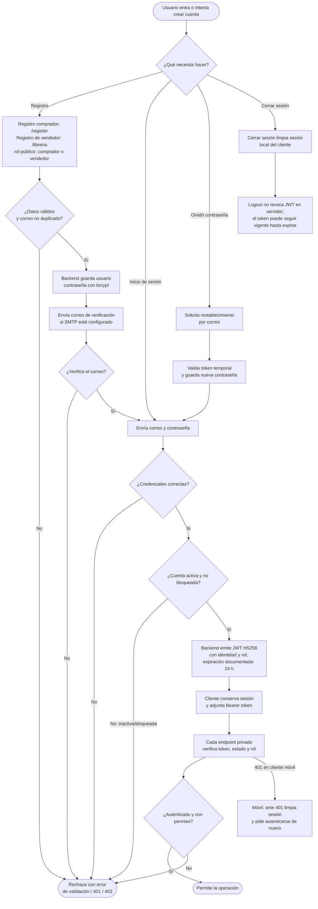

El inicio de sesión también puede rechazar vendedores con tienda suspendida. La interfaz protege rutas por sesión/rol, pero la autorización decisiva debe realizarse en la API; los patrones de comprobación varían entre routers. El registro público no permite crear cuentas administrativas. La documentación de autenticación y seguridad detalla JWT, bloqueo de cuentas, permisos y recuperación. En móvil, la restauración de sesión también comprueba vigencia del token y puede ofrecer desbloqueo biométrico; al recibir `401`, limpia la sesión.

## 4. Flujos funcionales del comprador

### 4.1 Descubrimiento, catálogo e interacción

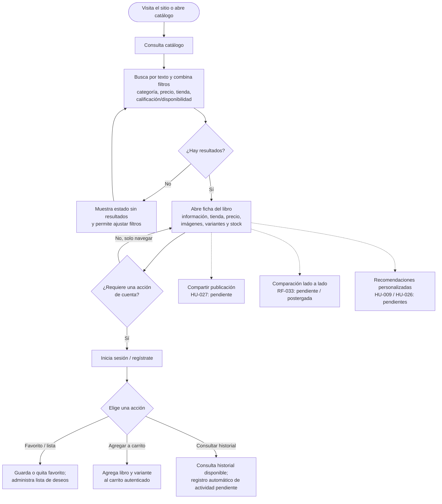

El catálogo público permite navegar, buscar, filtrar y consultar el detalle. Las acciones personales requieren autenticación. Compartir publicaciones y las recomendaciones no se encontraron implementadas; se muestran como pendientes, no como acciones activas. La pantalla de historial permite consultar interacciones, pero no se encontraron llamadas automáticas desde la navegación para registrarlas. RF-033 no se representa como una función terminada.

### 4.2 Carrito, checkout, pago y pedido

```mermaid
flowchart TD
    start([Comprador autenticado])
    mode{"¿Compra desde carrito<br/>o Comprar ahora?"}
    add["Agrega libro / variante<br/>y cantidad al carrito"]
    stockCart{"¿Producto disponible<br/>y cantidad válida?"}
    stockDirect{"¿Producto disponible<br/>y cantidad válida?"}
    reject([Muestra error de stock/datos])
    persist["Actualiza carrito<br/>según persistencia actual"]
    review["Revisa carrito"]
    direct["Desde el detalle selecciona<br/>libro/cantidad para Comprar ahora"]
    reviewDirect["Continúa al checkout<br/>directo"]
    quantity["Intenta cambiar la cantidad<br/>de un ítem existente"]
    partial["RF-034 parcial: la API no tiene<br/>operación independiente de actualización;<br/>agregar el mismo libro suma cantidad"]
    delivery{"¿Domicilio o retiro en tienda?"}
    address{"¿Dirección requerida<br/>y disponible?"}
    choose["Calcula subtotal, envío por tienda<br/>y total; retiro puede no cobrar envío"]
    coupon{"¿Comprador usa cupón?"}
    couponFlow["Valida cupón antes del pedido"]
    orderTiming{"¿Compra normal<br/>o Comprar ahora?"}
    order["Checkout del carrito crea<br/>orden pendiente y vacía carrito"]
    pay["Envía solicitud de pago"]
    payment{"¿Validaciones internas<br/>de pago satisfactorias?"}
    directOrder["Comprar ahora crea orden<br/>al iniciar la confirmación de pago;<br/>retira solo ese libro del carrito"]
    orderReady["Orden creada;<br/>continúa según entrega"]
    deliveryFlow{"¿Cómo se entrega?"}
    fail([Muestra rechazo o error;<br/>permite corregir/reintentar])
    paid["La aplicación registra pago/orden<br/>y procesos financieros/notificaciones"]
    shipping{"¿Tipo de entrega?"}
    ship["Vendedor despacha y registra<br/>empresa/guía de envío"]
    pickup["Reserva de retiro y PIN/fecha;<br/>aún no se cobra"]
    arrival["Comprador notifica que llegó<br/>a la tienda"]
    enablePickupPay["Vendedor verifica y habilita<br/>el pago de retiro"]
    pickupPay["Comprador realiza el pago"]
    pickupDelivery["Vendedor confirma entrega<br/>del libro"]
    couponUsed{"¿Se usó un cupón?"}
    applyCoupon["Tras el pago, intenta registrar<br/>el uso del cupón"]
    delivered["Se confirma entrega"]
    history["Comprador consulta pedidos,<br/>historial y estado"]
    cancel["Opcional: solicita cancelación;<br/>API actual no valida el estado permitido"]
    reviewAfter["Puede publicar reseña tras compra entregada;<br/>no hay distintivo visual verificado"]
    return["Puede solicitar devolución<br/>si la orden cumple elegibilidad;<br/>revisión/cambio de estado es limitado"]
    finish([Flujo de compra consultable])

    start --> mode
    mode -- "Carrito" --> add --> stockCart
    stockCart -- No --> reject
    stockCart -- Sí --> persist --> review
    review --> delivery
    review -. "Intento de cambiar cantidad" .-> quantity --> partial
    mode -- "Comprar ahora" --> direct --> stockDirect
    stockDirect -- No --> reject
    stockDirect -- Sí --> reviewDirect
    delivery -- Domicilio --> address
    address -- No --> fail
    address -- Sí --> choose
    delivery -- "Retiro en tienda" --> choose
    choose --> coupon
    coupon -- Sí --> couponFlow --> orderTiming
    coupon -- No --> orderTiming
    orderTiming -- "Carrito" --> order --> orderReady
    orderTiming -- "Comprar ahora" --> directOrder --> orderReady
    orderReady --> deliveryFlow
    deliveryFlow -- Domicilio --> pay
    deliveryFlow -- Retiro --> pickup --> arrival --> enablePickupPay --> pickupPay --> pay
    pay --> payment
    payment -- No --> fail
    payment -- Sí --> paid
    reviewDirect --> delivery
    paid --> shipping
    paid --> couponUsed
    couponUsed -- Sí --> applyCoupon --> history
    couponUsed -- No --> history
    paid --> history
    shipping -- Domicilio --> ship --> delivered
    shipping -- Retiro --> pickupDelivery
    pickupDelivery --> delivered
    delivered --> history
    history -. "Opcional, según estado" .-> cancel --> finish
    history -. "Opcional, si es elegible" .-> reviewAfter --> finish
    history -. "Opcional, si cumple condiciones" .-> return --> finish
```

La web y la app móvil ofrecen entrada al carrito, checkout y seguimiento, con pantallas distintas. El checkout normal crea una orden antes de pagar; «Comprar ahora» sigue una ruta que crea la orden al iniciar la confirmación de pago y quita ese libro del carrito. La pantalla valida el cupón antes del pedido y, tras un pago exitoso, intenta registrar su uso; los errores al aplicar el cupón no bloquean el mensaje de éxito. El endpoint de pago acepta montos menores al total sin comprobar que el descuento corresponda al cupón; el pago se anota en el registro de inconsistencias. Se calcula el envío por tienda; en retiro se genera una reserva/PIN, el comprador notifica su llegada y el vendedor habilita el pago y confirma la entrega. La confirmación de entrega despachada también puede ejecutarse automáticamente después de diez días desde el despacho.

Los almacenes JSON mantienen datos de carrito/órdenes y el backend intenta sincronizar partes con MySQL; ciertos fallos de persistencia SQL no cancelan todas las respuestas de la operación. La solicitud de pago se procesa dentro de la aplicación y se registra como aprobada por el flujo actual: no se identificó confirmación de una pasarela externa real. No se debe dibujar esta persistencia como una transacción distribuida atómica. Las devoluciones permiten consultar elegibilidad y registrar una solicitud; el router expone un flujo limitado para su decisión/cambio de estado.

## 5. Flujos del vendedor

### 5.1 Tienda, publicaciones e inventario

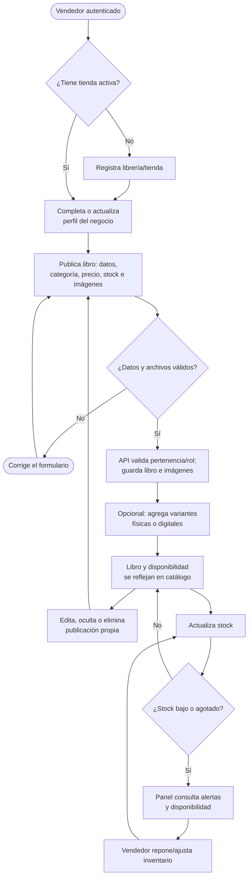

La API debe comprobar que el vendedor administra la tienda correspondiente. Las imágenes/archivos se almacenan aparte de las filas relacionales de MySQL; la disponibilidad depende del tipo de publicación y de su stock.

### 5.2 Pedidos, ofertas y herramientas de venta

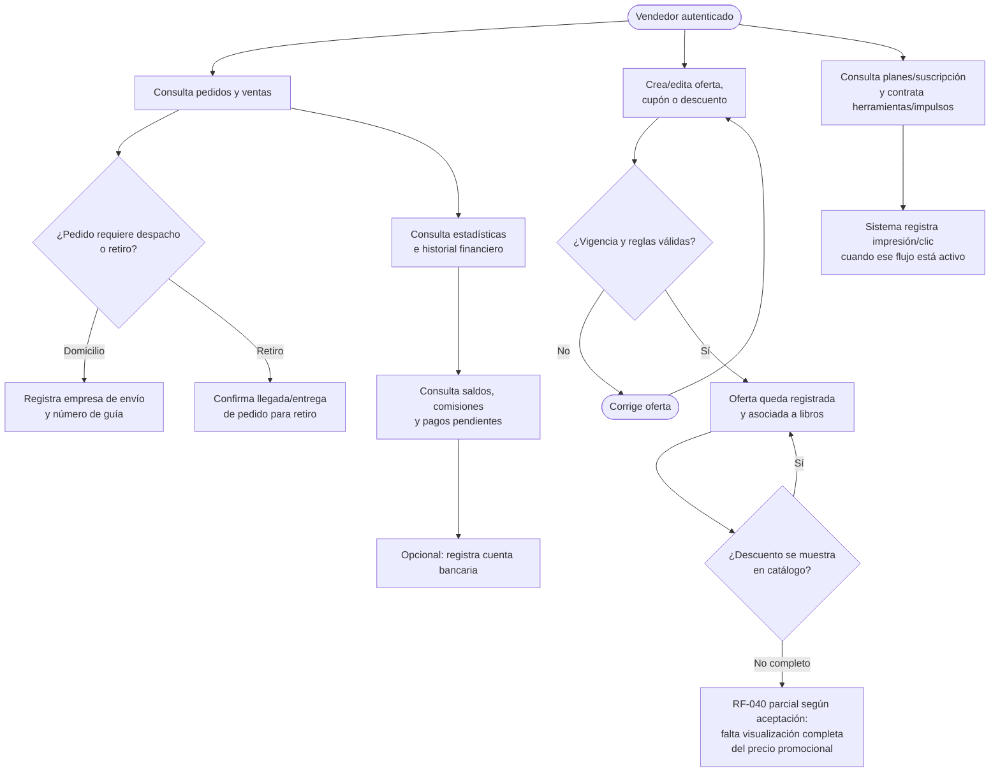

La documentación incluye BookyPago, cupones, promociones, suscripciones, impulsos, comisiones y retiros como módulos del vendedor/administración. Los diagramas reflejan el alcance documentado; el estado individual de cada operación debe verificarse en su pantalla, endpoint y modelo.

## 6. Comunidad, mensajería y soporte

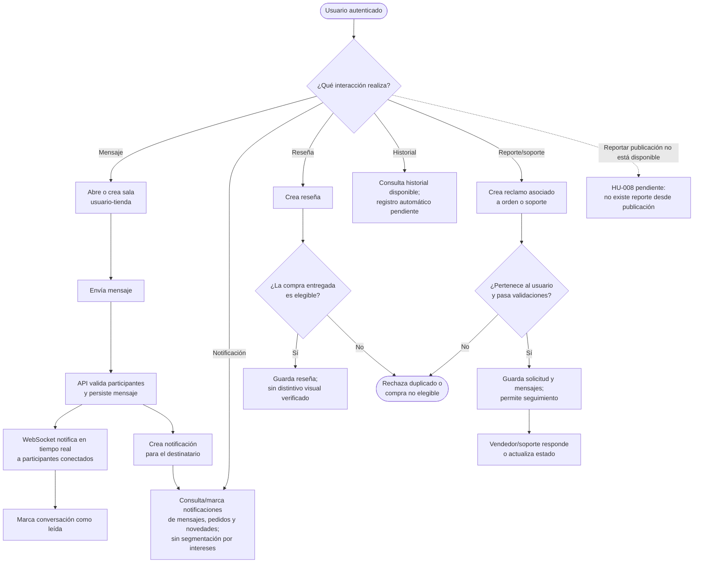

Los reclamos disponibles se asocian a órdenes o soporte; no se encontró una acción para reportar una publicación. Las reseñas solo se permiten tras una compra entregada, pero no se encontró distintivo visual de verificación. Consultar el historial no implica que la navegación registre actividad automáticamente. El canal en tiempo real es complementario al almacenamiento persistente del chat; no sustituye la consulta HTTP ni el control de permisos.

## 7. Administración y control

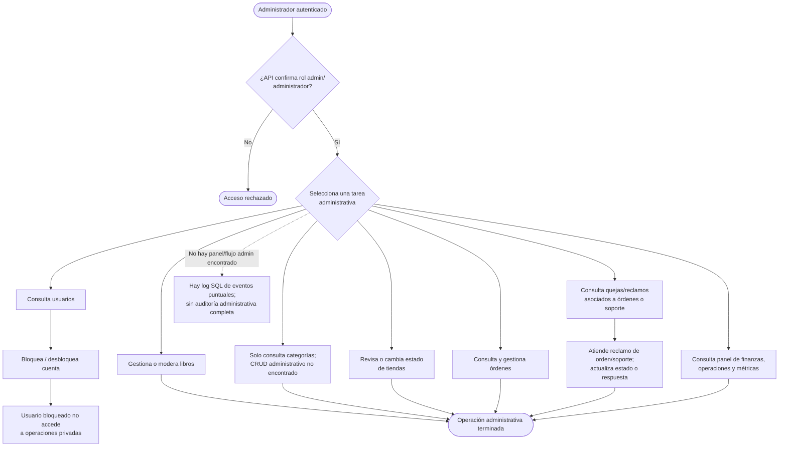

La protección de interfaz no reemplaza la comprobación de rol en el backend. El registro público no debe asignar privilegios administrativos. Se encontraron consultas de categorías, pero no operaciones administrativas CRUD; los reclamos de órdenes/soporte no equivalen a reportar una publicación. Existe la tabla `log_actividad` y hay triggers que registran algunos eventos SQL (por ejemplo, cancelaciones y eliminaciones), pero no se encontró un panel o flujo de auditoría administrativa completa.

## 8. Datos, migraciones y continuidad

### 8.1 Datos y migraciones

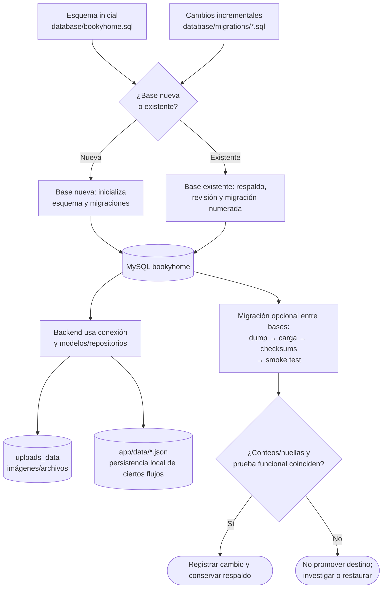

El esquema base, las migraciones, los datos JSON, los archivos subidos y las variables de entorno son elementos distintos. Los respaldos SQL no incluyen automáticamente los archivos del volumen ni los datos JSON locales; estos requieren procedimientos de copia independientes cuando sean necesarios.

### 8.2 Respaldo y restauración

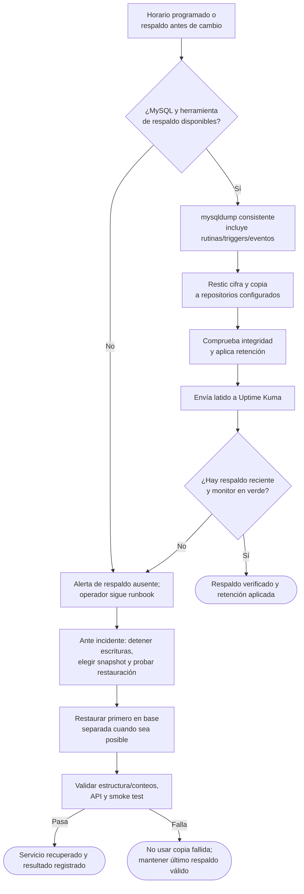

La documentación describe dos estrategias operativas que no deben confundirse: scripts PowerShell para respaldos locales de desarrollo y una ruta Linux con `mysqldump` + Restic, repositorios local/remoto, retención y latido de monitoreo. Los archivos subidos, JSON locales y secretos se gestionan por separado. El runbook diagnostica el healthcheck siguiendo proxy/red, backend y base de datos; el runbook del latido distingue servidor inaccesible, cron detenido, error del respaldo y fallo de notificación.

## 9. Cobertura funcional documentada

Las 42 historias de usuario se encuentran en `docs/requisitos/HIS/`; la conciliación HU-RF y los casos de uso ofrecen la trazabilidad completa. La siguiente agrupación ubica todas las historias en los flujos anteriores; una historia puede participar en más de un flujo.

| Grupo de flujo | Historias de usuario |
|---|---|
| Cuenta, perfil y acceso multidispositivo | HU-001, HU-014, HU-029, HU-030, HU-037, HU-038, HU-039 |
| Catálogo y publicaciones | HU-002, HU-003, HU-004, HU-010, HU-011, HU-012, HU-016, HU-019, HU-033, HU-040 |
| Compra, pedidos y entrega | HU-021, HU-022, HU-031, HU-032, HU-034, HU-041, HU-042 |
| Vendedor, negocio y promociones | HU-015, HU-020, HU-028 |
| Comunidad, historial y soporte | HU-005, HU-006, HU-007, HU-008, HU-009, HU-013, HU-017, HU-018, HU-023, HU-024, HU-026, HU-027, HU-035, HU-036 |
| Administración | HU-025 |

### Requisitos funcionales (RF)

Los estados de esta tabla reflejan el reporte de requisitos revisado en octubre de 2026: **I** = reportado implementado, **P** = parcial, **F** = pendiente. El diagrama no eleva requisitos parciales o pendientes a funciones completas.

| Flujo | RF relacionados | Estado documentado |
|---|---|---|
| Identidad, sesión y perfil | RF-001, RF-002, RF-003, RF-004, RF-015 | I |
| Publicación, catálogo, categorías y disponibilidad | RF-005, RF-006, RF-007, RF-008, RF-009, RF-010, RF-018, RF-037, RF-038, RF-039 | I según reporte; RF-018 en discrepancia |
| Comunicación, comunidad y actividad | RF-011, RF-012, RF-013, RF-014, RF-016, RF-017, RF-031, RF-035, RF-041 | I |
| Carrito, pagos, pedidos y envíos | RF-023, RF-024, RF-025, RF-032, RF-034 | RF-034 P; los demás I |
| Reportes y administración | RF-019, RF-020, RF-021, RF-022, RF-036 | I |
| Recomendaciones, difusión, métricas y sincronización | RF-026, RF-027, RF-028, RF-029, RF-030 | I según reporte; HU-009/HU-026/HU-027 y segmentación de HU-035 no verificadas |
| Comparación de libros | RF-033 | F |
| Promociones y descuentos visibles | RF-040 | P |

**Limitaciones conocidas de aceptación:** RF-034 no ofrece actualización independiente de cantidad de un ítem; RF-040 tiene gestión de ofertas, pero la aceptación documenta que el precio promocional no se muestra completamente en catálogo; RF-033 no está implementado y aparece postergado al roadmap v2. RF-018 figura como implementado en el reporte y se asocia a HU-040, pero no se encontraron las rutas CRUD de categorías que ese requisito enumera; la historia se mantiene como pendiente en el registro de inconsistencias. La calificación de tiendas se documenta como implementada en un módulo, pero su router no está registrado en `main.py`, por lo que no se debe presentarla como una ruta activa sin verificar.

### Requisitos no funcionales (RNF)

Los requisitos no funcionales son condiciones transversales, no pasos de negocio. El reporte de requisitos los marca como implementados; la evaluación de calidad aporta una conclusión más cauta, basada en evidencia y mediciones. Se conserva aquí la evaluación detallada para evitar presentar cumplimiento no medido como hecho.

| RNF | Aspecto | Evaluación documentada |
|---|---|---|
| RNF-001 | Seguridad de datos | Parcial |
| RNF-002 | Seguridad de accesos | Parcial |
| RNF-003 | Rendimiento | Parcial |
| RNF-004 | Escalabilidad | Parcial |
| RNF-005 | Alta disponibilidad | Parcial |
| RNF-006 | Mantenibilidad | Parcial |
| RNF-007 | Compatibilidad | Parcial |
| RNF-008 | Usabilidad | Parcial avanzado |
| RNF-009 | Conformidad legal | Parcial; falta validación jurídica |
| RNF-010 | Tiempo de respuesta | Parcial; faltan mediciones representativas |
| RNF-011 | Recuperación | Cumple en ambiente local según las pruebas documentadas |
| RNF-012 | Eficiencia de recursos | Parcial |

## 10. Operación, monitoreo y calidad

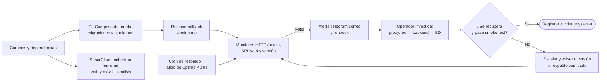

La calidad y operación asociadas incluyen pruebas unitarias del backend y suites de los clientes, pruebas de humo, SonarCloud, auditoría de dependencias, actualización de componentes, monitoreo de salud, runbooks y mantenimiento. El workflow SonarCloud ejecuta análisis/cobertura para backend, web y móvil; el paso de pruebas web puede continuar aunque falle. El plan de testing fechado al inicio de octubre refleja una línea base anterior a las suites/workflows actuales y no debe leerse como inventario vigente. Las pruebas de aceptación registran 18 de 20 casos ejecutados, con defectos abiertos de RF-034 y RF-040 y RF-033 omitido/postergado.

## 11. Fuentes y notas de consistencia

### Documentación consultada

- [Requisitos funcionales y no funcionales](../REPORTE_REQUISITOS.md), [conciliación RF-HU](../requisitos/CONCILIACION_RF.md), historias en `../requisitos/HIS/` y requisitos en `../requisitos/RF/` y `../requisitos/RNF/`.
- [Casos de uso](../casos-de-uso/README.md), [diagramas de secuencia](../diagramas-de-secuencia/diagramas-secuencia-bookyhome.md) y [diagrama de clases](../diagramas-de-clases/diagrama-clases-bookyhome.md).
- [Manual de usuario](../manuales/manual-usuario.md), [manual técnico](../manuales/manual-tecnico.md), [manual de instalación](../manuales/manual-instalacion.md) y guías de [autenticación](../modulos/autenticacion.md) y [registro](../modulos/registro.md).
- [Plan de implantación](../implantacion/plan-implantacion.md), [plan de migración](../implantacion/entregable-s02-planes.md), estrategia de [hosting y dominio](../implantacion/entregable-s03-hosting-y-dominio.md), [despliegue](../implantacion/entregable-s04-procedimiento-despliegue.md), [configuración y verificación](../implantacion/entregable-s05-configuracion-y-verificacion.md), [seguridad y respaldos](../implantacion/entregable-s06-seguridad-y-respaldo.md), [pipeline y monitoreo](../implantacion/entregable-s07-pipeline-y-monitoreo.md), [mantenimiento y soporte](../implantacion/entregable-s08-mantenimiento-soporte-y-capacitacion.md), [aceptación](../implantacion/entregable-s09-aceptacion-y-entrega.md), automatización de [instalación](../implantacion/entregable-s10-instalacion-ejecutable.md), [actas](../implantacion/acta-despliegue.md) y [runbooks](../runbooks/).
- [Plan de testing](../calidad/plan-de-pruebas.md), [evaluación de RNF](../calidad/evaluacion-rnf.md), [cobertura de pruebas](../calidad/cobertura-tests.md), [auditoría de dependencias](../calidad/auditoria-dependencias.md), [refactorización](../calidad/evaluacion-refactorizacion-backend.md), [lecciones aprendidas](../calidad/bitacora-lecciones-aprendidas.md), [informe de calidad](../manuales/informe-calidad.md) y [marco de calidad](../calidad/marco-calidad-psp.md).
- [Compose local](../../docker-compose.yml), [Compose producción](../../deploy/compose.prod.yaml), [Caddy producción](../../deploy/Caddyfile.prod), [CI](../../.github/workflows/ci.yml), [release](../../.github/workflows/release.yml), [rollback](../../.github/workflows/rollback.yml), scripts operativos, `infra/` y `database/`.

### Diferencias que deben conservarse al leer los diagramas

1. Los requisitos describen el producto objetivo; los endpoints y las pantallas actuales determinan qué está implementado hoy.
2. Los documentos de calidad contienen evaluaciones más recientes o más cautas que algunos resúmenes de requisitos. En especial, no se afirma que todos los RNF estén plenamente verificados.
3. La documentación contempla varias rutas de despliegue: Compose local, servidor Linux con Caddy, infraestructura automatizada y Render con Aiven Cloud MySQL 8.4 LTS (solución desplegada y verificada en producción pública).
4. El carrito, las órdenes, MySQL y los archivos subidos no se deben resumir como una única persistencia. Las secuencias originales describen JSON como almacén principal de ciertos flujos y SQL como sincronización secundaria; el código vigente es la referencia final.
5. Las guías y reportes pueden diferir en nombres de rutas, estados o alcance. Antes de usar este documento para certificar una entrega, actualizar la trazabilidad con los endpoints activos y el resultado de aceptación más reciente.
6. El archivo raíz `reportes.md` describe exportación PDF/Excel por fechas, pero esa descripción por sí sola no confirma que exista actualmente un endpoint o pantalla operativa; la lista de routers de API no incluye un router separado de reportes. La nota de `registro.md` sobre correo institucional también debe contrastarse con las validaciones vigentes antes de tratarla como una regla implementada.
7. El `CHANGELOG.md` mantiene como no liberados la integración con una pasarela externa real, las notificaciones push móviles, analítica avanzada para vendedores e internacionalización. No se dibujan como funciones actuales.

### Referencias adicionales del proyecto

- [Documentación principal](../../README.md), [backend](../../backend/README.md), [web](../../frontend/README.md), [app móvil](../../app-movil/README.md).
- [Migraciones de BD](../../database/migrations/README.md), [respaldos](../implantacion/plan-migracion-respaldos.md), [ayuda al usuario](../ayuda/guia-rapida.md) y [preguntas frecuentes](../ayuda/preguntas-frecuentes.md).
